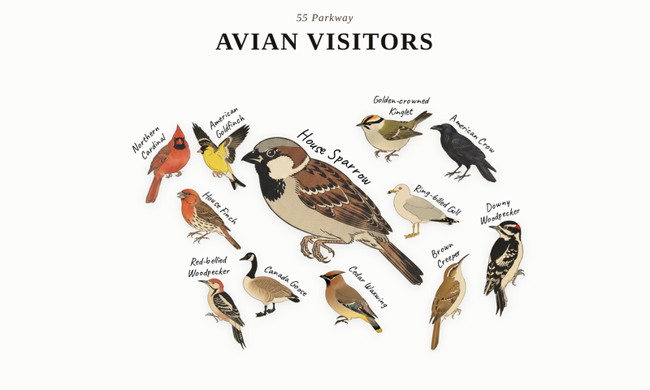
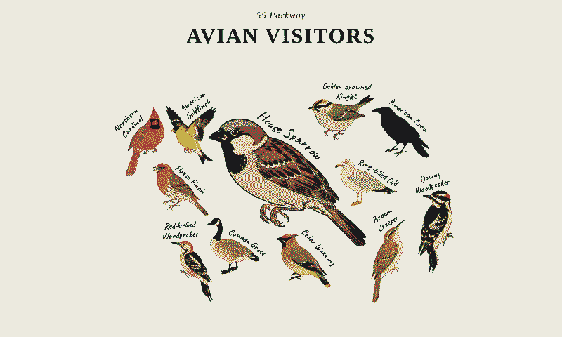
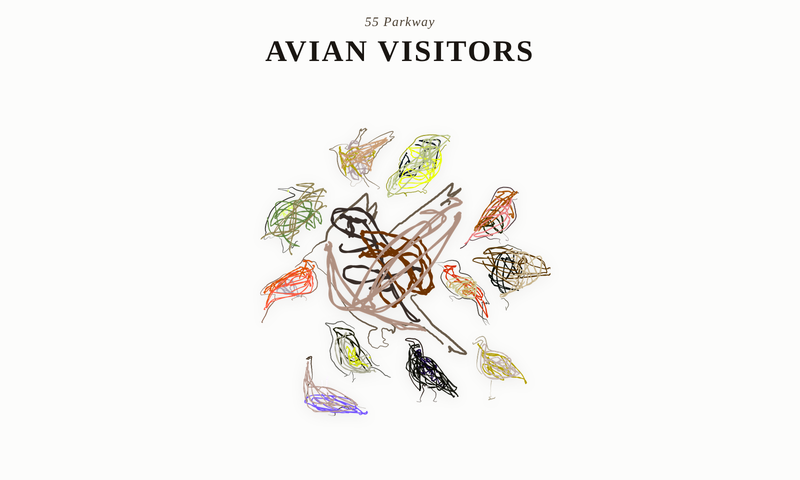
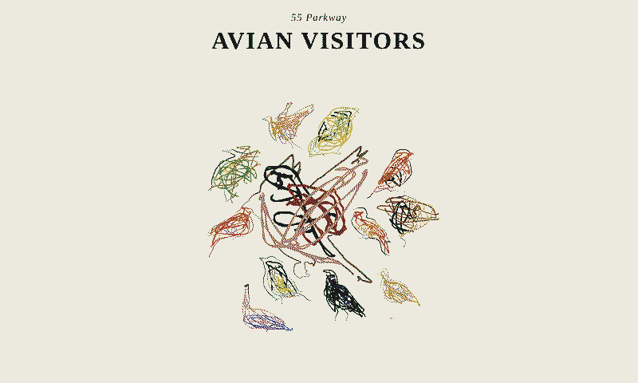
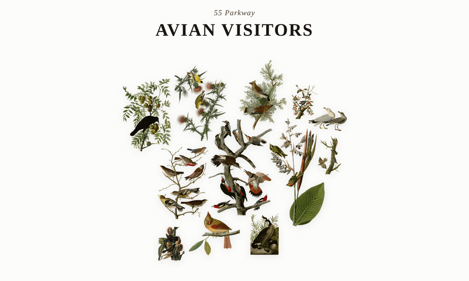
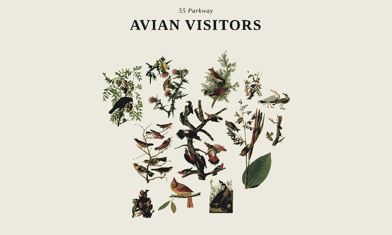
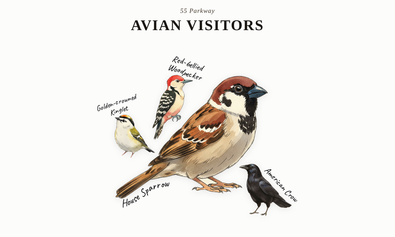
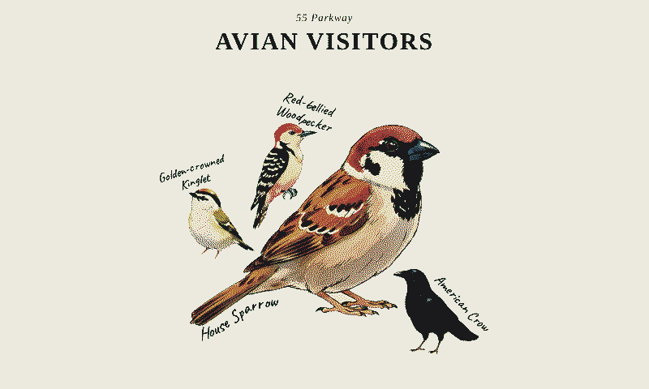

# Style previews

Live birds from the configured station, rendered in each style. Left: full colour. Right: what the 6-colour e-paper panel will show.

## Japanese Woodblock (current)  (`STYLE=woodblock`)

12 birds: House Sparrow, Red-bellied Woodpecker, Golden-crowned Kinglet, American Goldfinch, House Finch, American Crow, Cedar Waxwing, Northern Cardinal, Canada Goose, Downy Woodpecker, Brown Creeper, Ring-billed Gull

 

## Evolutionary Impressionist  (`STYLE=impressionist`)

12 birds: House Sparrow, Red-bellied Woodpecker, Golden-crowned Kinglet, American Goldfinch, House Finch, American Crow, Cedar Waxwing, Northern Cardinal, Canada Goose, Downy Woodpecker, Brown Creeper, Ring-billed Gull

 

## Audubon - Birds of America  (`STYLE=audubon`)

12 birds: Red-bellied Woodpecker, Golden-crowned Kinglet, American Goldfinch, House Finch, American Crow, Cedar Waxwing, Northern Cardinal, Canada Goose, Downy Woodpecker, Brown Creeper, Ring-billed Gull, Common Grackle

 

## Ghibli-style (generated)  (`STYLE=ghibli`)

4 birds: House Sparrow, Red-bellied Woodpecker, Golden-crowned Kinglet, American Crow

 
